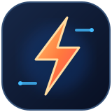
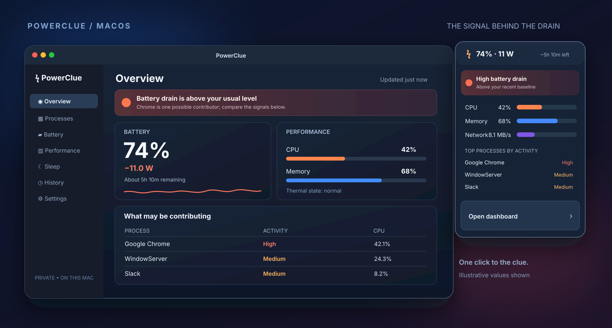

<div align="center">
  
  <h1>PowerClue</h1>
  <p><strong>Find the clue behind your Mac's battery drain and slowdowns.</strong></p>
  <p>A native, private power and performance monitor for macOS.</p>
  <p>
    
    
    
    
  </p>
</div>


PowerClue lives in the menu bar and turns raw system readings into useful leads: how fast the battery is draining, what the Mac is doing, which processes are active, and what happened during sleep. Open the dashboard when you want the detail behind a warning.

## At a glance



<p align="center"><em>Illustration of the current interface. Values are examples, not measurements from a particular Mac.</em></p>

| See the signal | Follow the clue |
| --- | --- |
| **Battery** — charge, power source, live output when available, and 1/5/15-minute drain averages. | Compare current drain with your own recent baseline instead of guessing from a single reading. |
| **Power Mission** — set a runtime goal and test one change while on battery. | Compare whole-Mac power before and after. PowerClue shows an approximate time gain only when the reading is clear enough. |
| **Performance** — CPU, memory, swap, network, disk, thermal state, and Low Power Mode. | Spot a system-wide bottleneck and check how it changes over time. |
| **Processes** — CPU, memory footprint, wakeups, disk I/O, network traffic, and power assertions where macOS exposes them. | Search, sort, group by app, and inspect the signals behind an **Activity** rating. |
| **Sleep & history** — local charts and reports for sleep sessions observed while PowerClue runs. | Compare charge before and after sleep, review wake events, and revisit trends from earlier in the day. |

## Read the numbers honestly

**Activity** is a relative investigation hint built from CPU, wakeups, disk, network, and sleep-prevention signals. A **High** rating means “look here first”; it is not a measured percentage of battery use.

On supported Apple Silicon Macs, **CPU W** estimates a process's *CPU-only* power over the sampling interval using macOS CPU energy accounting. It does not include the display, GPU, network, disk, or shared system work, so it is not that process's total battery draw. Unavailable values appear as `—`.

The menu bar's battery watts describe the Mac's battery output when the hardware provides it. They should not be added to or directly compared with the per-process **CPU W** estimates.

## Power Mission

Open **Mission** from the dashboard or menu bar, choose a runtime goal, then pick one change to test: turn on Low Power Mode, pause an app, disconnect a display, or make another change. PowerClue records battery output before the change, asks you to mark when you made it, and records the same amount of time afterwards. Each stage allows 15 seconds to settle and measures for 90 seconds.

The result compares median **whole-Mac battery watts**, not per-process watts. A possible runtime gain uses the macOS time estimate and the before/after power ratio, so it is approximate. Noisy readings or a large CPU workload change produce an **inconclusive** result. One comparison is useful evidence, not proof that the action caused the difference. The current run stays visible while PowerClue is open; mission results are not yet stored in history.

## Build and run

Requires **macOS 14 or later** on Apple Silicon or Intel. No account or administrator access is needed.

```sh
./scripts/build-app.sh
open dist/PowerClue.app
```

The script builds an ad hoc signed local app bundle at `dist/PowerClue.app`. Click the lightning bolt in the menu bar, then choose **Open dashboard**. You can also open this Swift Package in Xcode.

## How it works

PowerClue samples public macOS system APIs and uses the system `nettop` and `pmset` utilities for the signals they expose. It samples every second while its menu or dashboard is visible, every five seconds in the background, and every twelve seconds in Low Power Mode except during a Mission measurement, when it samples every five seconds. Polling pauses during system sleep.

History is stored locally in SQLite: detailed samples for **48 hours** and one-minute aggregates for **30 days**. Charts cover the last five minutes through 24 hours. The database remains under `Application Support/EasyActivityMonitor/history.sqlite` so existing users keep their history after the rename.

Some processes restrict access to their metrics; PowerClue shows unavailable values rather than inventing them. Sleep reports record before/after charge, wake events, reasons, and assertions seen before sleep. They suggest possible contributors, not proven causes. A full sleep/wake cycle on your Mac is needed to verify a report there.

<div align="center">
  <p><strong>Clarity for the curious Mac user.</strong></p>
  <p>Built with Swift and SwiftUI. Data stays on your Mac.</p>
</div>
